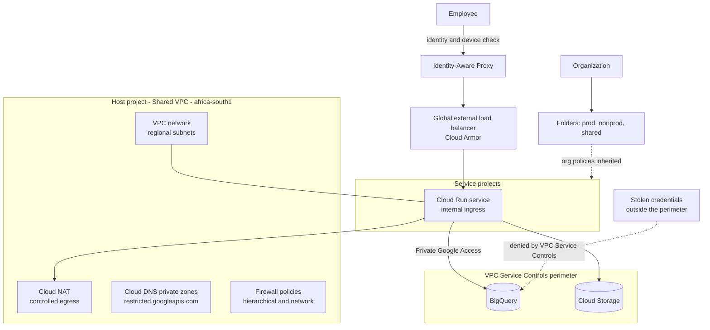
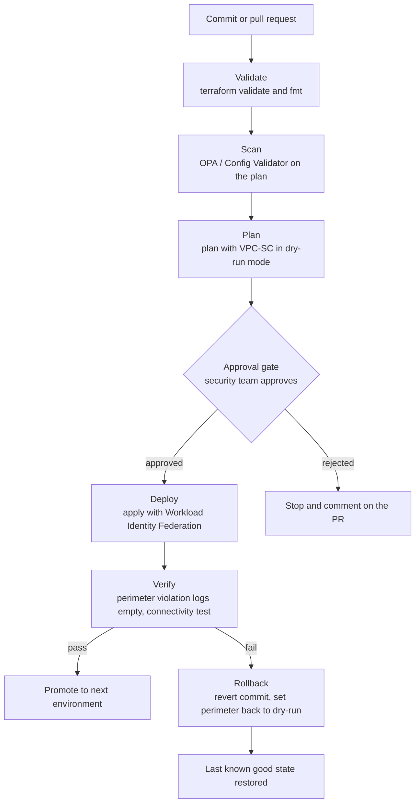
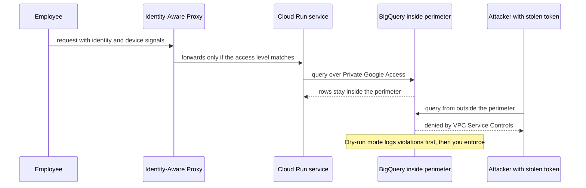

# Zero-Trust Landing Zone

A Google Cloud organization built from Terraform with folders, Shared VPC, Private Service Connect, org policies and VPC Service Controls perimeters that stop data leaving even when credentials are stolen.

### Business use case

A data-heavy South African company (retail analytics, health, fintech) keeps its crown jewels in BigQuery and Cloud Storage. It wants to prove that nobody outside a defined boundary can read or copy that data, and to see who can reach what.

### The hard piece

Zero-trust access (VPC Service Controls and IAP) with org policy as code

### Rough monthly cost, ZAR

R400 to R1,200 a month with teardown. The load balancer, Cloud NAT and Cloud Armor are the main costs. VPC Service Controls itself has no charge.

### Tool stack

- Resource Manager hierarchy
- Terraform + Cloud Foundation Fabric
- Org Policy constraints
- Shared VPC
- Hierarchical firewall policies
- Cloud NAT
- Cloud DNS private zones
- Private Service Connect
- Global external load balancer + Cloud Armor
- Identity-Aware Proxy
- VPC Service Controls + Access Context Manager
- Cloud Audit Logs sinks
- Security Command Center
- GitHub Actions + Workload Identity Federation
- OPA / Config Validator

### Diagrams

#### Diagram 1 · Architecture: hierarchy, Shared VPC and the perimeter

> **How to read this:** Employees reach the service only through IAP, which checks who they are and what device they use. The service talks to BigQuery and Cloud Storage inside the perimeter. The dotted line on the right is the point of the project: an attacker with a valid token but outside the perimeter is refused, which IAM alone cannot do.

#### Diagram 2 · CI/CD: org policy and network changes

> **How to read this:** Follow the top line from a commit to a deploy: the pipeline stops at the first red step, and nothing reaches the approval gate unless validation, scanning and the plan all passed. The bottom branch is the one hiring managers ask about: when verification fails, the rollback box puts the environment back without a human editing the console.

#### Diagram 3 · Hard piece: a request through IAP and the perimeter

> **How to read this:** Two requests, two outcomes. The employee passes identity and device checks, and the service reads data privately. The attacker has a valid credential but the request comes from outside the perimeter, so the API call is refused. Start the perimeter in dry-run and read the logs before you enforce it.

### How it covers the five focus areas

- **Compute** (light): Cloud Run behind IAP, IAP TCP tunnelling instead of a bastion host, org policy that blocks external IPs and limits machine types.
- **Networking · HOME**: Shared VPC with subnet-level IAM, hierarchical and network firewall policies using tags, Cloud NAT, private DNS with restricted Google APIs, Private Service Connect, global load balancer with Cloud Armor, VPC Service Controls perimeters with ingress and egress rules.
- **Storage** (light): Uniform bucket-level access, public access prevention by org policy, CMEK in Cloud KMS, a log bucket with a retention lock.
- **CI/CD** (deep): Workload Identity Federation (no service account keys), plan in dry-run, approval, apply, perimeter log check.
- **Cost optimisation** (light): Folder-level budgets, label policy, quota limits, billing export enabled from day one.
### Advanced features that show depth

- VPC Service Controls rolled out in dry-run, with a log analysis step before enforcement
- Context-aware access with IAP and Access Context Manager levels
- Custom org policy constraints written in CEL
- Resource Manager tags driving firewall policy rules
- Subnet-level IAM on the Shared VPC so teams cannot attach to each other's subnets

### Production-like touches

- Prod, nonprod and shared folders with their own policies
- Alerts on perimeter violations and org policy changes
- Runbook: onboard a new project into the perimeter
- Post-incident write-up: a service blocked by the perimeter, and the ingress rule that fixed it
- Hierarchy diagram and IP plan in the repo

### AWS to GCP bridge

| AWS | Google Cloud | Where it differs |
| --- | --- | --- |
| Organizations + OUs | Organization + folders | Policies and IAM inherit down the tree, and IAM is additive: a role granted high up cannot be taken away lower down. |
| SCP | Org Policy constraints (+ IAM deny) | Org Policy limits configuration. IAM deny policies block permissions. |
| VPC (regional) | VPC (global) with regional subnets | One VPC spans every region. Isolation comes from projects and firewall policy, not separate VPCs. |
| Security group | Firewall rules and policies | Rules target tags or service accounts, and they can be hierarchical. |
| PrivateLink | Private Service Connect | Endpoint-based, with an address in your subnet. |
| Data perimeter (VPC endpoint policies + SCP) | VPC Service Controls | A first-class perimeter around APIs. There is no direct AWS equivalent. |

### Résumé pitch

- Built a Terraform-managed Google Cloud organization with Shared VPC, \[N\] org policies and VPC Service Controls, blocking data exfiltration in testing from outside the perimeter.
- Replaced service account keys with Workload Identity Federation across \[N\] pipelines.
- Rolled out perimeter enforcement using dry-run log analysis, with zero production outages.

> *Replace every \[N\] with a number you measured. If you cannot measure it, remove the claim.*
